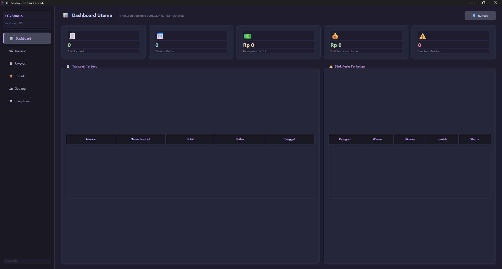
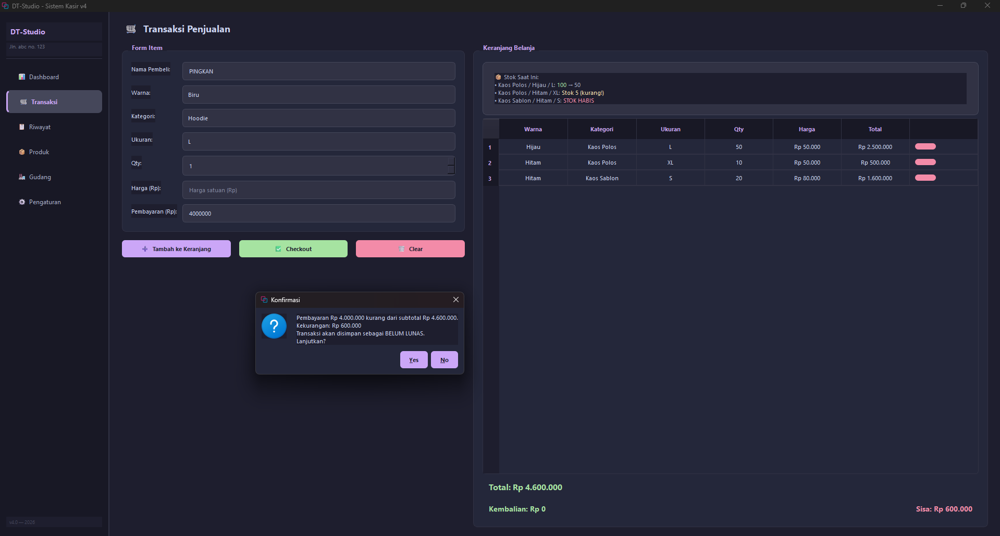
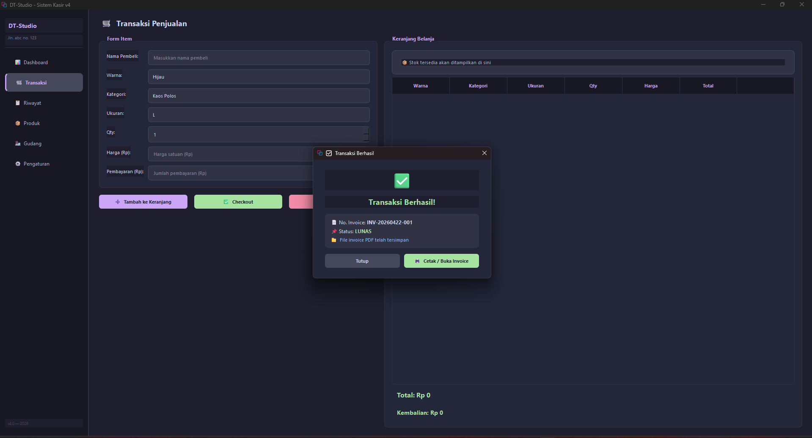
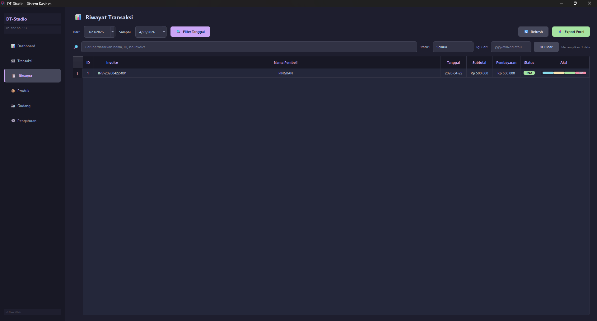
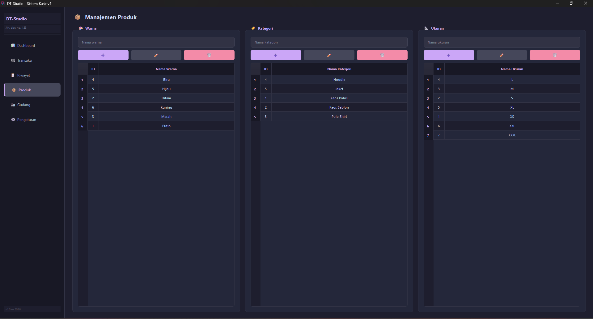
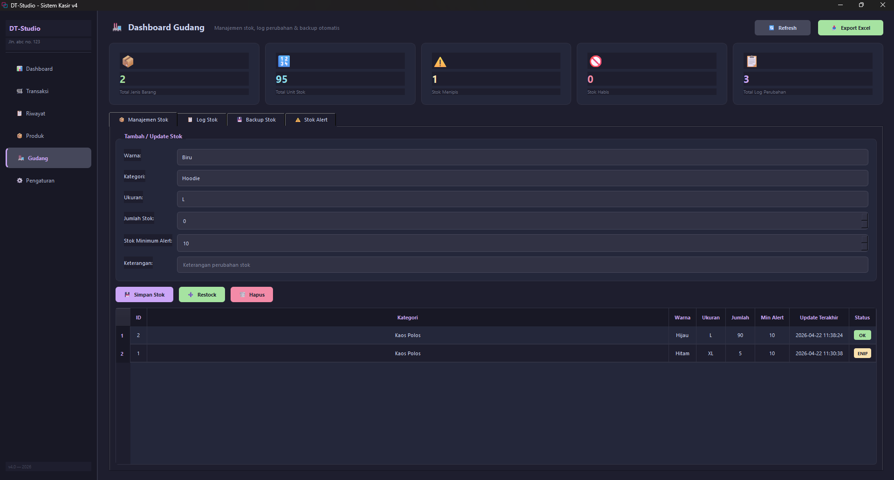
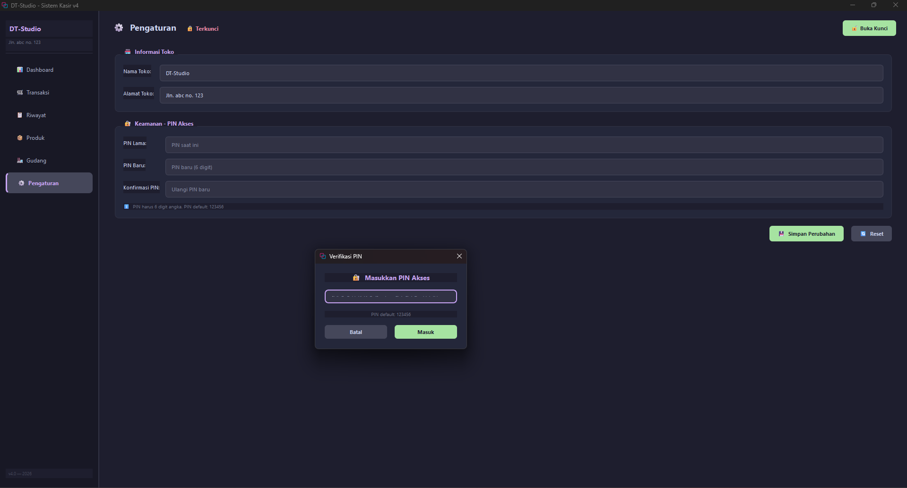

# 🛒 Sistem Kasir v4 — Panduan Penggunaan & Penjelasan Script

> Aplikasi kasir desktop berbasis Python + PyQt6 dengan manajemen produk, transaksi, gudang, invoice PDF, dan ekspor Excel.
---

## 📋 Daftar Isi

1. [Persyaratan Sistem](#persyaratan-sistem)
2. [Instalasi](#instalasi)
3. [Cara Menjalankan](#cara-menjalankan)
4. [Panduan Penggunaan](#panduan-penggunaan)
   - [Dashboard](#1-dashboard)
   - [Transaksi](#2-transaksi)
   - [Riwayat Transaksi](#3-riwayat-transaksi)
   - [Produk](#4-produk)
   - [Gudang](#5-gudang)
   - [Pengaturan](#6-pengaturan)
5. [Struktur Folder](#struktur-folder)
6. [Cara Kerja Script](#cara-kerja-script)
7. [Database & Tabel](#database--tabel)
8. [Troubleshooting](#troubleshooting)

---















## Persyaratan Sistem

| Kebutuhan | Versi Minimum |
|---|---|
| Python | 3.10+ |
| Sistem Operasi | Windows 10/11, macOS, Linux |
| RAM | 512 MB |
| Penyimpanan | 100 MB |

---

## Instalasi

**1. Clone atau ekstrak project**
```bash
unzip NEW-KASIR.zip
cd NEW-KASIR
```

**2. (Opsional) Buat virtual environment**
```bash
python -m venv venv
# Windows:
venv\Scripts\activate
# macOS/Linux:
source venv/bin/activate
```

**3. Install semua dependensi**
```bash
pip install -r req.txt
```

Isi `req.txt`:
```
PyQt6
reportlab
qrcode
Pillow
openpyxl
pandas
numpy
```

---

## Cara Menjalankan

```bash
python main.py
```

Saat pertama kali dijalankan, folder `database/` akan dibuat otomatis beserta file `database.db`.

> **Catatan:** Pastikan file `database/icon.ico` tersedia agar ikon aplikasi tampil dengan benar.

---

## Panduan Penggunaan

### 1. Dashboard

Halaman utama yang muncul saat aplikasi dibuka. Menampilkan:

- **Statistik hari ini** — jumlah transaksi, total pendapatan, dan status stok gudang
- **Transaksi terbaru** — daftar transaksi terakhir beserta status (Lunas / Belum Lunas)
- **Stok menipis / habis** — peringatan produk yang perlu di-restock

Dashboard ter-refresh otomatis setiap kali navigasi kembali ke halaman ini.

---

### 2. Transaksi

Halaman untuk membuat transaksi penjualan baru.

Halaman dibagi menjadi dua container di sisi kiri — **Form Item** dan **Pembayaran** — dan keranjang di sisi kanan.

**Langkah membuat transaksi:**

1. Pilih **Warna**, **Kategori**, dan **Ukuran** produk dari dropdown
2. Isi **Qty** (jumlah) dan **Harga Satuan** — atau klik salah satu dari **3 tombol saran harga** di bawah kolom Harga
3. Klik **Tambah ke Keranjang** — item akan masuk ke tabel keranjang di sebelah kanan
4. Ulangi langkah 1–3 untuk item tambahan
5. Di container **Pembayaran**, isi **Nama Pembeli** dan jumlah pembayaran — atau klik salah satu **saran pembayaran**
6. Klik **Checkout** untuk menyelesaikan transaksi

**Saran harga**
- Tiga tombol di bawah kolom Harga, nilainya diatur di menu **Pengaturan → Saran Harga** (bawaan: Rp 35.000 / 45.000 / 55.000).
- Perubahan di Pengaturan langsung berlaku tanpa restart.

**Saran pembayaran**
- Muncul otomatis di bawah kolom Pembayaran dan berubah mengikuti total keranjang.
- Berisi **Uang Pas** ditambah 2 nominal hasil pembulatan ke atas (kelipatan 10 rb / 50 rb / 100 rb).
- Contoh: total Rp 520.000 → `Uang Pas`, `Rp 550.000`, `Rp 600.000`.

Setelah checkout:
- Invoice PDF digenerate otomatis dan bisa langsung dibuka
- Stok gudang berkurang secara otomatis sesuai qty yang dibeli
- Transaksi tersimpan ke database dengan nomor invoice unik

> **Hapus item keranjang:** Klik tombol ✕ di baris item yang ingin dihapus sebelum checkout.

---

### 3. Riwayat Transaksi

Menampilkan seluruh riwayat transaksi yang pernah dilakukan.

**Fitur yang tersedia:**

- **Filter tanggal** — tampilkan transaksi berdasarkan rentang tanggal tertentu
- **Lihat detail** — klik tombol 👁 untuk melihat detail item per transaksi
- **Update pembayaran** — klik ✏️ untuk memperbarui jumlah pembayaran; status berubah otomatis menjadi *Lunas* jika sudah mencukupi
- **Cetak ulang invoice** — klik 🖨 untuk mencetak ulang invoice PDF untuk transaksi yang sudah ada
- **Hapus transaksi** — klik 🗑 (memerlukan PIN)
- **Export Excel** — ekspor seluruh riwayat transaksi ke file `.xlsx`

---

### 4. Produk

Halaman manajemen atribut produk. Produk didefinisikan oleh kombinasi tiga atribut:

| Atribut | Contoh |
|---|---|
| **Warna** | Merah, Biru, Hitam |
| **Kategori** | Baju, Celana, Jaket |
| **Ukuran** | S, M, L, XL, XXL |

**Cara menambah atribut:**
1. Ketik nama atribut di kolom input
2. Klik tombol **Tambah**

**Cara menghapus atribut:**
1. Klik baris yang ingin dihapus di tabel
2. Klik tombol **Hapus**

> ⚠️ Perubahan pada atribut produk akan langsung memperbarui dropdown di halaman Transaksi dan data di Gudang.

---

### 5. Gudang

Halaman manajemen stok inventori.

**Sub-tab yang tersedia:**

#### Stok Barang
- Menampilkan semua kombinasi produk beserta jumlah stok saat ini
- Indikator warna:
  - 🟢 **OK** — stok di atas batas minimum
  - 🟡 **Menipis** — stok mendekati atau sama dengan batas minimum
  - 🔴 **Habis** — stok = 0
- Klik **Edit Stok** untuk menambah atau mengurangi jumlah stok
- Atur **Stok Minimum** per produk sebagai ambang batas peringatan

#### Log Stok
- Riwayat lengkap semua perubahan stok (masuk/keluar) beserta timestamp
- Mencatat otomatis setiap transaksi penjualan dan perubahan manual

#### Restock
- Form khusus untuk menambah stok massal
- Catat sumber restock dan keterangan

**Export Excel:** Klik tombol **📤 Export Excel** untuk mengekspor seluruh data gudang ke file `.xlsx`.

---

### 6. Pengaturan

Halaman konfigurasi aplikasi. Dilindungi oleh **PIN** (default: `123456`).

**Yang bisa diubah:**
- Nama Toko — ditampilkan di sidebar, judul window, dan invoice PDF
- Alamat Toko — ditampilkan di sidebar dan invoice PDF
- Saran Harga — 3 nominal untuk tombol cepat di bawah kolom Harga pada halaman Transaksi
- PIN Akses — ganti PIN untuk keamanan pengaturan

> Perubahan nama/alamat toko dan saran harga langsung berlaku setelah disimpan, tanpa perlu restart aplikasi.

---

## Struktur Folder

```
NEW-KASIR/
│
├── main.py                  # Entry point — controller utama & layout aplikasi
├── database.py              # Modul database transaksi & produk
├── db_gudang.py             # Modul database gudang (stok & log)
├── invoice.py               # Generator invoice PDF (ReportLab)
├── excel.py                 # Eksporter Excel (openpyxl + pandas)
├── req.txt                  # Daftar dependensi Python
├── invoice/                 # Hasil invoice PDF (lunas/ dan belum_lunas/, dibuat otomatis)
│
├── ui/
│   ├── styles.py            # Tema dark mode (CSS/QSS)
│   ├── table_utils.py       # Helper tabel (tinggi baris, badge status, tombol aksi)
│   ├── dashboard.py         # Halaman dashboard/beranda
│   ├── transaction_ui.py    # Halaman transaksi & riwayat
│   ├── product_ui.py        # Halaman manajemen produk
│   ├── warehouse_dashboard.py  # Halaman gudang
│   └── settings_ui.py       # Halaman pengaturan
│
├── utils/
│   └── helpers.py           # Fungsi helper (format rupiah, parse currency)
│
└── database/
    ├── database.db          # File database SQLite (dibuat otomatis)
    └── icon.ico             # Ikon aplikasi
```

---

## Cara Kerja Script

### Alur Aplikasi Secara Keseluruhan

```
main.py (KasirApp)
    │
    ├── Database()          ← database.py
    ├── DatabaseGudang()    ← db_gudang.py
    │
    ├── Sidebar Navigation (6 tombol)
    │
    └── QStackedWidget (6 halaman)
         ├── [0] MainDashboard
         ├── [1] TransactionTab
         ├── [2] DetailTransaksiTab
         ├── [3] ProductTab
         ├── [4] WarehouseDashboard
         └── [5] SettingsTab
```

---

### `main.py` — Controller Utama

File ini adalah inti aplikasi. Tugasnya:

1. **Menginisialisasi** dua database (`Database` dan `DatabaseGudang`)
2. **Membangun layout** aplikasi: sidebar di kiri + `QStackedWidget` di kanan
3. **Mengelola navigasi** — setiap klik tombol sidebar memanggil `_navigate(index)` yang mengganti halaman aktif dan memanggil method `refresh()` pada halaman tersebut
4. **Meneruskan callback** `_on_produk_changed()` ke `ProductTab`, sehingga saat data produk berubah, dropdown di Transaksi dan tabel di Gudang ikut diperbarui secara otomatis
5. **Meneruskan callback** `_on_toko_changed()` ke `SettingsTab`, sehingga saat pengaturan disimpan, label sidebar, judul window, info toko di invoice, dan saran harga di Transaksi langsung diperbarui

```
Klik nav button → _navigate(i) → stack.setCurrentIndex(i) → page.refresh()
```

---

### `database.py` — Database Utama

Menggunakan **SQLite** dengan mode WAL (Write-Ahead Logging) untuk performa dan keamanan data. Setiap operasi database dibungkus dalam context manager `_get_conn()` yang otomatis melakukan commit jika berhasil, atau rollback jika terjadi error.

**Tabel yang dikelola:**
- `warna`, `kategori`, `ukuran` — master data atribut produk
- `transaksi` — header transaksi (nama pembeli, total, status, no. invoice)
- `detail_transaksi` — item per transaksi (produk, qty, harga)
- `pengaturan` — konfigurasi toko (nama, alamat, PIN, saran harga). Kolom `saran_harga` ditambahkan otomatis (migrasi) pada database lama

---

### `db_gudang.py` — Database Gudang

Berbagi file `database.db` yang sama dengan `database.py`, namun mengelola tabel-tabel tersendiri:

- `stok_barang` — jumlah stok per kombinasi (warna × kategori × ukuran)
- `log_stok` — riwayat setiap perubahan stok beserta waktu dan keterangan

Setiap kali transaksi selesai di `TransactionTab`, stok di tabel `stok_barang` dikurangi dan entri baru ditambahkan ke `log_stok` secara otomatis.

---

### `invoice.py` — Generator Invoice PDF

Menggunakan library **ReportLab** untuk membuat invoice PDF berformat profesional. Fitur:

- Layout A4 dengan header toko (nama & alamat)
- Tabel item transaksi
- Ringkasan pembayaran dengan urutan **Subtotal → Pembayaran → Sisa Pembayaran**. Jika pembayaran melebihi subtotal, baris terakhir otomatis berubah menjadi **Kembalian**
- **QR Code** berisi data verifikasi invoice (nomor invoice, status, subtotal, pembayaran, sisa/kembalian), di-generate dengan library `qrcode`
- Garis dekoratif kustom (`DecorativeLine`, rata tengah sejajar dengan tabel) dan watermark status pembayaran
- File PDF disimpan di folder `invoice/lunas/` atau `invoice/belum_lunas/` sesuai status, dengan nama berdasarkan nomor invoice, nama toko, tanggal, dan nama pembeli

---

### `excel.py` — Eksporter Excel

Menggunakan **openpyxl** dan **pandas** untuk menghasilkan file `.xlsx` terformat:

- `ExcelExporter` — mengekspor data transaksi dengan styling (warna header, border, format Rupiah)
- `ExcelExporterGudang` — mengekspor data stok gudang dan log perubahan
- Mendukung pembuatan grafik (pie chart, bar chart) langsung di dalam file Excel

---

### `ui/styles.py` — Tema Visual

Mendefinisikan tema dark mode (`DARK_THEME`) dalam format QSS (Qt Style Sheets) — setara dengan CSS untuk aplikasi PyQt. Warna tema mengikuti palet **Catppuccin Mocha** (nuansa ungu dan biru gelap).

### `ui/table_utils.py` — Helper Tabel

Memastikan semua tabel punya tinggi baris tetap (46 px) agar badge status dan tombol aksi tidak terpotong:
- `setup_table(tbl)` — terapkan tinggi baris & header
- `make_badge(teks, style)` — badge status berukuran sesuai teks
- `make_table_button(...)` / `make_button_group([...])` — tombol aksi berukuran tetap, rata tengah di sel

---

### `utils/helpers.py` — Fungsi Pembantu

Tiga fungsi kecil yang dipakai di banyak tempat:
- `format_rupiah(amount)` — mengubah integer menjadi string `"Rp 10.000"`
- `parse_currency(text)` — kebalikannya, mengubah string Rupiah kembali ke integer
- `format_perubahan(nilai)` — menambah tanda `+` atau `-` pada angka perubahan stok

---

## Database & Tabel

File database: `database/database.db` (SQLite)

| Tabel | Isi |
|---|---|
| `warna` | Master data warna produk |
| `kategori` | Master data kategori produk |
| `ukuran` | Master data ukuran produk |
| `transaksi` | Header setiap transaksi penjualan |
| `detail_transaksi` | Detail item per transaksi |
| `pengaturan` | Konfigurasi toko (nama, alamat, PIN, saran harga) |
| `stok_barang` | Stok saat ini per kombinasi produk |
| `log_stok` | Log histori semua perubahan stok |

---

## Troubleshooting

**Aplikasi tidak bisa dibuka / error saat start**
- Pastikan semua dependensi sudah diinstall: `pip install -r req.txt`
- Pastikan Python versi 3.10 ke atas

**Dropdown produk kosong di halaman Transaksi**
- Buka halaman **Produk** dan tambahkan minimal satu Warna, Kategori, dan Ukuran terlebih dahulu

**Invoice PDF tidak terbuka otomatis**
- File PDF tetap tersimpan di folder `invoice/lunas/` atau `invoice/belum_lunas/` — buka secara manual dari sana
- Pastikan ada aplikasi PDF reader yang terinstall di sistem

**PIN pengaturan lupa**
- PIN default adalah `123456`
- Jika sudah diganti dan lupa, buka `database/database.db` menggunakan SQLite browser dan reset nilai kolom `pin_akses` di tabel `pengaturan`

**Error database saat pertama kali jalan**
- Hapus folder `database/` dan jalankan ulang — database akan dibuat ulang dari awal

---

> Dibuat dengan ❤️ menggunakan Python, PyQt6, ReportLab, dan openpyxl.
